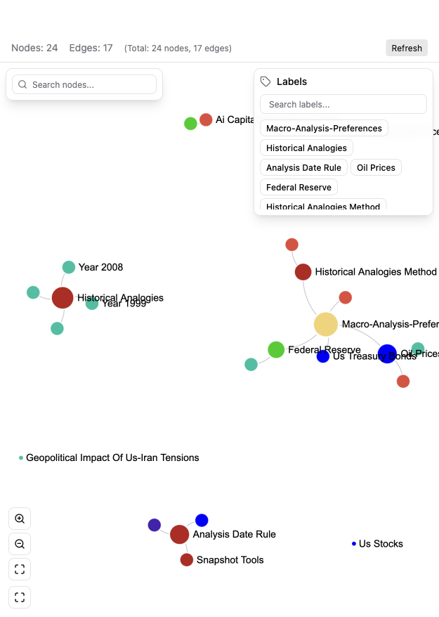
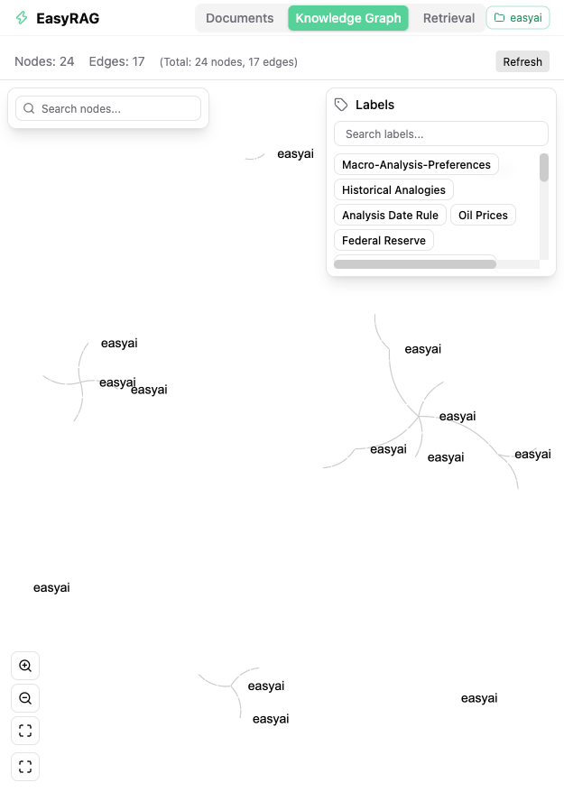

# EasyRAG

[](https://github.com/haibingzhao/easyrag/actions/workflows/ci.yml)
[](LICENSE)

一个用 Rust 从零实现的生产级 RAG（Retrieval-Augmented Generation）知识库检索系统。

- **检索引擎**：向量检索 + 全文检索（RRF 混合排序）+ 知识图谱，支持多路召回
- **可插拔存储**：JSON 文件（零依赖开箱即用）/ PostgreSQL + pgvector / Neo4j / Tantivy / 内存
- **完整流水线**：文档解析（PDF / Word / Excel / HTML / Markdown）→ 上下文感知分块 → 向量化入库 → 实体抽取建图
- **多租户**：workspace 隔离 + biz_id 业务线过滤 + 租户级配置覆盖
- **自带 Web UI**：文档管理、知识图谱可视化、对话式检索
- **OpenAI 兼容**：任何 OpenAI 兼容端点（OpenAI、DashScope、Ollama 等）均可接入



## 功能特性

| 能力 | 说明 |
| --- | --- |
| 混合检索 | 向量语义检索 + 关键词全文检索，RRF 融合排序；可选 Jina/Cohere 重排 |
| 知识图谱 | LLM 实体抽取自动建图，支持子图查询与可视化浏览 |
| 文档解析 | PDF、Word、Excel、HTML、Markdown、纯文本；多模态文档（图片表格）处理 |
| 上下文感知分块 | 基于文档结构树的语义分块，保留标题层级上下文 |
| 多租户 | workspace 隔离、biz_id 业务线过滤、租户级 LLM/分块配置覆盖 |
| 认证 | JWT 认证 + BCrypt 凭证 + 登录滑动窗口限流 |
| 后台自动扫描 | 定时轮询/目录扫描任务，增量入库（easy-rss 多任务模式）|
| Ollama 兼容 API | 暴露 Ollama 风格端点，可接入现有 Ollama 生态工具 |
| 评估 | 内置检索质量评估（覆盖率 / 幻觉率）|
| LLM 缓存 | 基于角色的响应缓存与并发控制 |

## 架构

Cargo workspace 由 6 个 crate 组成，依赖方向自上而下：

```
easyrag-app        # 可执行入口：装配存储/LLM/管线，启动 HTTP 服务与后台扫描
└── easyrag-server # HTTP/SSE API 层（axum）：文档、查询、图谱、评估、认证、租户配置
    └── easyrag-pipeline  # IngestionPipeline / QueryEngine / 多模态处理
        ├── easyrag-llm     # OpenAI/Ollama 兼容客户端、重排、缓存
        └── easyrag-storage # 多后端存储：内存 / JSON / PostgreSQL / Neo4j / Tantivy
            └── easyrag-core   # 核心契约（trait）与领域模型
```



## 快速开始

### 前置要求

- Rust 1.86+（`rustup` 安装）
- Node.js 18+（Web UI）
- 可选：PostgreSQL 15+（含 pgvector 扩展）、Neo4j 5.x —— 不装也能跑，默认使用本地 JSON 存储

### 1. 配置环境变量

```bash
cp .env.example .env
# 编辑 .env：至少填写 LLM 与 Embedding 的 API Key
```

最小可用配置只需三行（`STORAGE_BACKEND` 默认 `json`，无需数据库）：

```dotenv
LLM_BINDING_HOST=https://api.openai.com/v1
LLM_BINDING_API_KEY=sk-xxx
LLM_MODEL=gpt-4o-mini
```

Embedding 默认读 OpenAI 兼容端点，可单独通过 `EMBEDDING_*` 变量指定不同服务商。

### 2. 启动后端

```bash
cargo run --release -p easyrag-app
# 服务默认监听 http://0.0.0.0:8020
```

### 3. 启动 Web UI

```bash
cd easyrag-webui
npm install
npm run dev
# 打开终端提示的地址（默认 http://localhost:5173）
```

### 4. 登录

首次启动会自动播种默认管理员（用户存储为空时），并在日志中打印 WARN 提醒：

- 用户名：`admin`
- 密码：`admin`

**请在首次登录后立即修改密码**（生产环境务必设置强 `JWT_SECRET`，服务端在密钥为内置默认值或不足 32 字节时会拒绝启动）。

## 环境变量

完整变量清单见 [.env.example](.env.example)，核心分组：

| 分组 | 关键变量 | 说明 |
| --- | --- | --- |
| LLM | `LLM_BINDING_HOST` / `LLM_BINDING_API_KEY` / `LLM_MODEL` | OpenAI 兼容端点 |
| 存储 | `STORAGE_BACKEND` | `json`（默认）/ `memory` / `postgres` |
| PostgreSQL | `PG_HOST` / `PG_PORT` / `PG_USER` / `PG_PASSWORD` / `PG_DATABASE` | `postgres` 后端必填 |
| Embedding | `EMBEDDING_BINDING_HOST` / `EMBEDDING_MODEL` / `EMBEDDING_DIM` | 维度需与模型一致 |
| 图谱 | `GRAPH_STORAGE_TYPE=neo4j` + `NEO4J_*` | 可选，不配则禁用图谱 |
| 认证 | `AUTH_ENABLED` / `JWT_SECRET` | 默认开启，密钥 ≥ 32 字节 |
| 后台扫描 | `AUTO_SCAN_ENABLED` / `AUTO_SCAN_TASKS` / `AUTO_SCAN_INPUT_DIR` | 默认关闭 |

## API 概览

服务启动后，所有 REST 端点挂载在 `http://localhost:8020` 下（除健康检查与登录外均需 `Authorization: Bearer <token>`）：

| 模块 | 路径前缀 | 功能 |
| --- | --- | --- |
| 认证 | `/auth/*` | 登录、注册 |
| 文档 | `/documents/*` | 上传、列表、删除、状态查询 |
| 查询 | `/query` 等 | 检索 + 对话（含 SSE 流式）|
| 图谱 | `/graph/*` | 知识图谱子图查询 |
| 租户 | `/tenant/*` | workspace 级配置覆盖 |
| 健康 | `/health` | 存活探针 |

## 开发

```bash
cargo build            # 编译
cargo test             # 全量测试（含各存储后端契约测试）
cargo clippy           # lint
cargo fmt              # 格式化

cd easyrag-webui
npm run lint           # 前端 lint
npm run build          # 前端构建
```

集成测试默认使用内存存储，无需外部数据库；涉及 PostgreSQL / Neo4j / Tantivy 的集成测试位于各 crate 的 `tests/` 目录，按需启动本地服务后运行。

## 项目结构

```
crates/
├── easyrag-core/      # 核心契约：StorageNameSpace / LLM / Embedding trait、领域模型、并发原语
├── easyrag-storage/   # 存储后端实现：memory / json / postgres+pgvector / neo4j / tantivy
├── easyrag-llm/       # LLM 客户端：openai / ollama / rerank / cache / 角色路由
├── easyrag-pipeline/  # 管线：解析、分块、抽取、入库、查询引擎、评估、多模态
├── easyrag-server/    # HTTP 层：axum 路由、认证、服务编排
└── easyrag-app/       # 二进制入口：配置装配、后台自动扫描
easyrag-webui/         # React + Vite + Zustand 前端：文档管理 / 图谱可视化 / 对话检索
```

## License

[Apache-2.0](LICENSE)
